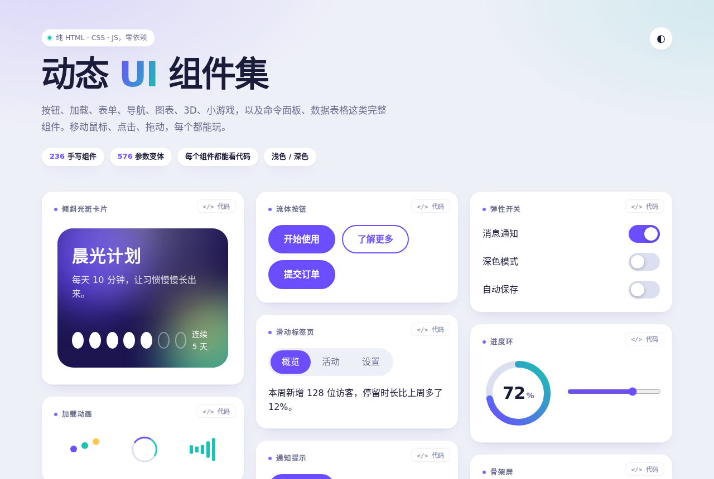

# 动态 UI 组件集

> 🌐 **在线预览**：https://ibi6.github.io/ui-components-oss/

一个纯前端的动态 UI 组件合集：按钮、加载动画、开关、表单、导航、图表、3D、小游戏，以及命令面板、数据表格、前后对比滑块这类完整组件。没有构建步骤，没有第三方依赖，打开 `index.html` 就能看、能点、能拖。



## 数量（说清楚）

| 类别 | 数量 |
| --- | --- |
| 页面顶部的主要组件 | 19 |
| 「组件图鉴」里手写的组件 | 217 |
| **手写组件合计** | **236** |
| 参数组合生成的变体（按钮组合、动效组合） | 576 |

后面那 576 个是同一套代码换颜色、圆角、大小、时长和缓动生成的，不是 576 种不同的设计。很多手写组件之间也是同一思路的变体，真正彼此不同的设计比 236 要少。

## 快速开始

```bash
git clone <你的仓库地址>
cd ui-components
python3 -m http.server 8000     # 然后打开 http://localhost:8000
# 也可以直接双击 index.html 看页面，但 </> 面板读不到样式表（原因见下文「代码面板」）
```

只想要一个文件：运行 `python3 build.py`，会生成 `dist/ui-components.single.html`（CSS 和 JS 都内联）。

## 功能

- 每个组件（顶部 19 个主要组件和图鉴里的全部组件）右上角都有 `</>` 按钮，点开看代码，点“复制”一键复制。
- 页面支持浅色和深色（跟随系统，也可以用页面里的“深色模式”开关切换）。
- 命令面板可以用 `Ctrl/⌘ + K` 唤起。
- 顶部卡片按阅读顺序瀑布流排列；图鉴有分类跳转。
- 「按钮组合」「动效组合」两组共 576 个变体默认折叠，点开才显示。
- 系统开启“减少动态效果”时，动画会自动停用。

## 组件清单（图鉴）

- 按钮悬停效果（20）
- 加载动画（16）
- 卡片悬停效果（9）
- 文字特效（10）
- 表单控件（8）
- 导航与菜单（6）
- 动态背景（8）
- 鼠标特效（8）
- 数据可视化（6）
- 列表与表格（8）
- 时间轴与评论（6）
- 图表（8）
- 分页与选择器（6）
- 提示与反馈（6）
- 卡片（5）
- 抽屉与弹层（4）
- 图片（3）
- 滚动特效（3）
- 图标动画（4）
- 表单校验（4）
- 页头与回顶（2）
- 开关与滑块（6）
- 按钮点击反馈（5）
- 3D 效果（5）
- 小工具与小游戏（5）
- 更多文字特效（4）
- 光标与指针（3）
- 视差与倾斜（2）
- 徽章与标签（4）
- 进度与骨架（3）
- 完整小组件（6）
- 实用小组件（8）
- 完整界面（5）
- 更多界面（4）
- 常用完整组件（7）

## 代码面板

`</>` 面板里的代码是页面在运行时从 `css/style.css` 的**原始源码**里提取的，每个组件包含：

- 组件的 HTML 结构；
- 匹配到的 CSS 规则（原文）；
- 用到的 `:root` 变量（只含浅色值）、`@keyframes` 和 `@property`；
- 一小段页面基础样式（背景、字体），方便直接粘贴到空白页面里预览。

复制后放进一个带 `<!doctype html>` 的 HTML 文件，**纯 CSS 的组件可以直接运行**。

限制：

- **不包含 JavaScript**。有 JS 交互的组件（命令面板、数据表格、验证码、日期范围、拖拽排序、滑块数值气泡等）会在代码开头加一条注记，并列出可以到 `js/main.js` 里搜索的关键字。注记是按类名和属性匹配的，同类组件里只有一部分用到 JS 时，其他组件也会带这条注记（宁可多提示）。
- 悬停、点击这类状态的 CSS 规则会包含在内，但只验证过静态外观，没有逐个验证悬停和点击效果。
- 只提取了浅色主题的变量值。
- 从本地文件（`file://`）直接双击打开 `index.html` 时，浏览器不允许脚本读取外部样式表，面板里会提示这一点；请用本地服务器（`python3 -m http.server`），或者使用 `dist/ui-components.single.html`。

### 自动验证

`python3 tools/verify_copy.py` 会把每个组件的面板代码放进空白页面，和原页面里的组件对比第一帧外观。最近一次运行覆盖了全部手写组件，以及每组生成变体中的前 8 个，共 233 个：229 个一致。另外 4 个有差异，原因都能解释：命令面板（列表由 JS 生成，且测试视口不够宽）、两个依赖 JS 状态的组件，以及一个文字特效（图鉴格子的背景带淡渐变，粘贴到纯色背景上有像素级差异，效果本身一致）。

## 浏览器兼容

只在 **Chromium（Chrome/Edge）** 里实际测试过。用到了 `@property`、`:has()`、`conic-gradient`、`clip-path`、`backdrop-filter`，Safari 16.4+ 和较新的 Firefox 理论上能用，**但没有验证过**，欢迎提 issue 反馈。移动端只检查了页面没有横向溢出，没有在真机上测过触摸交互。

## 已知问题

- 代码是分批追加出来的，没有模块化：CSS 里有重复规则，类名风格不统一，`js/main.js` 按“期”分块。欢迎重构。
- 「拖拽排序」用的是浏览器自带的拖拽，**触屏设备不支持**。
- 「前后对比」用渐变色块代替真实图片；「日期范围」只有单月；「命令面板」的最近使用不持久化。
- 天气、播放器、购物车、登录、聊天、文件下载等都是**假数据和模拟交互**，没有连接任何后端。
- CSS 变量名曾经和主题色变量冲突过（`--y`、`--a`，已改名为 `--cy`、`--ka` 等），新增组件时请避免和 `:root` 里的变量重名。

## 项目结构

```
index.html          页面骨架（顶部的主要组件）
css/style.css       全部样式
js/main.js          全部交互（含图鉴的生成、代码面板、各组件逻辑）
build.py            合并成单文件
dist/               单文件构建产物
tools/              验证脚本（verify_copy.py）
docs/preview.png    预览图
```

## 参与贡献

欢迎 issue 和 PR。比较有价值的方向：Safari/Firefox/真机的兼容性修复、把组件拆成独立文件（每个组件自带完整的 HTML、CSS、JS）、触屏支持、补上没做的组件（分享面板、通知中心、抽奖转盘、瀑布流、新手引导、双滑块）。

## 说明

本项目的代码由 Claude（Anthropic）辅助生成，并经过人工审阅和基本的浏览器测试（无控制台报错、主要交互手动点过），但没有完整的自动化测试。

## 许可证

[MIT](LICENSE)
